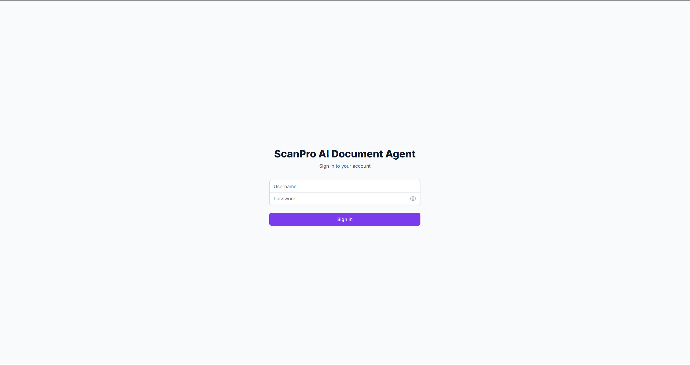
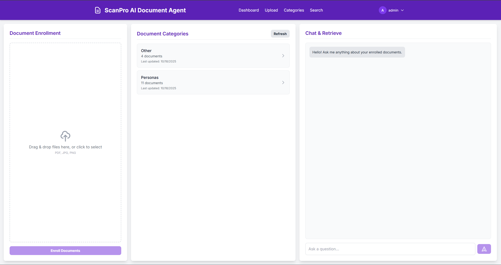
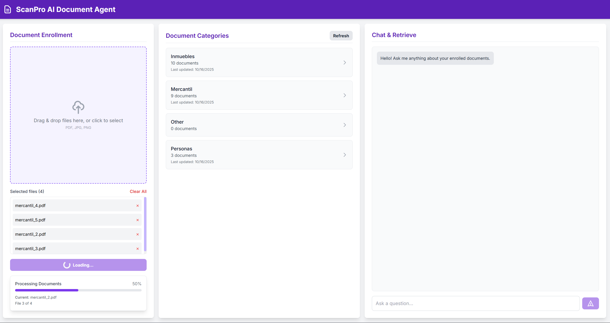
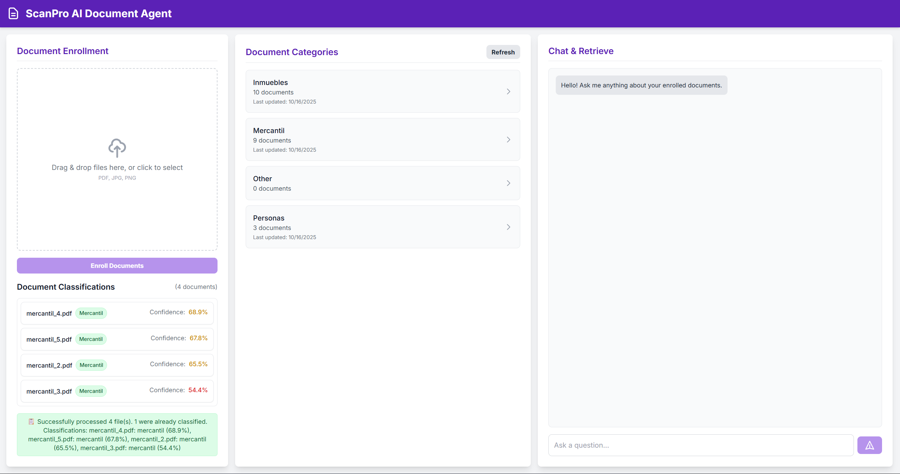
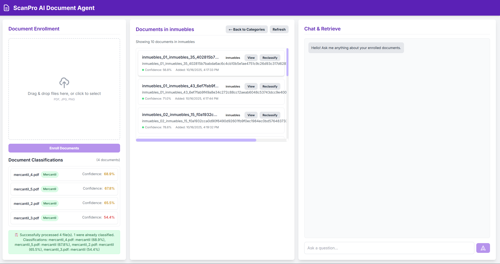
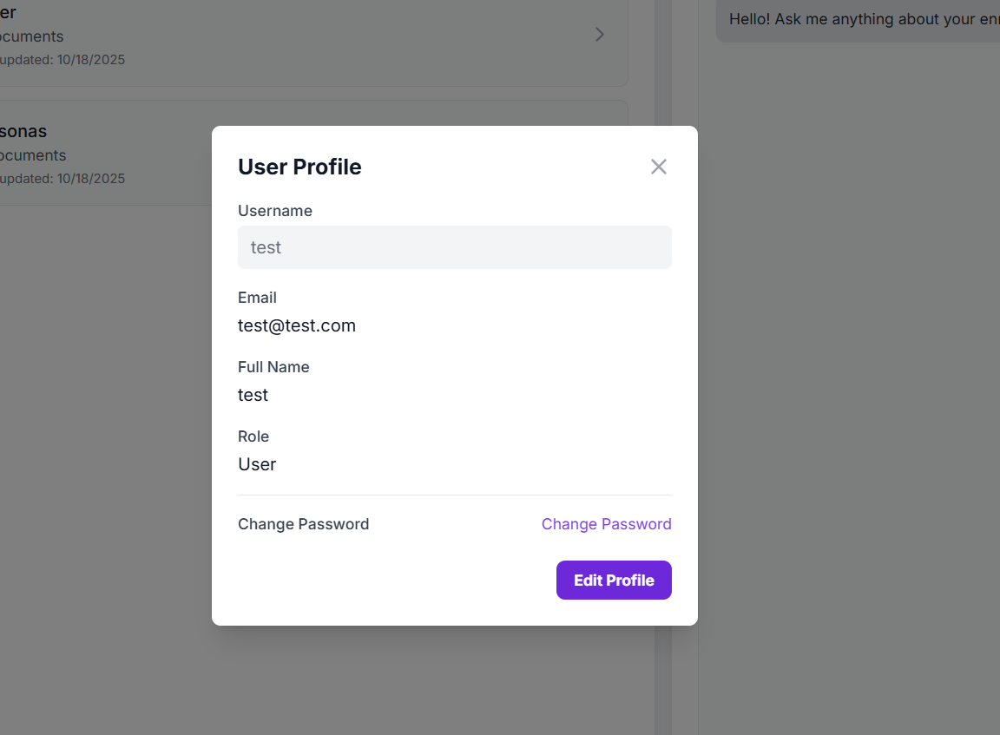
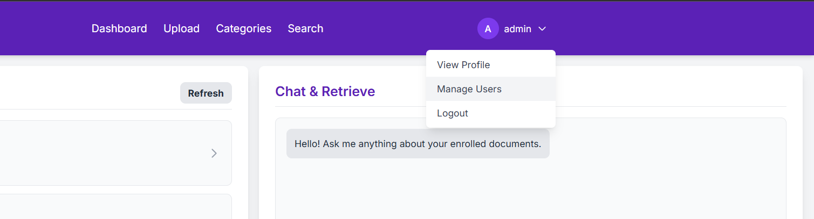
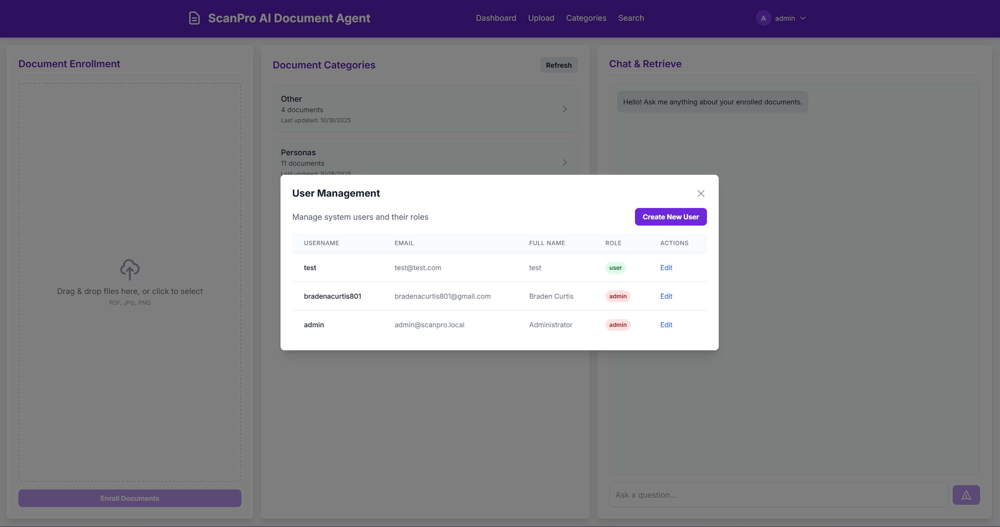
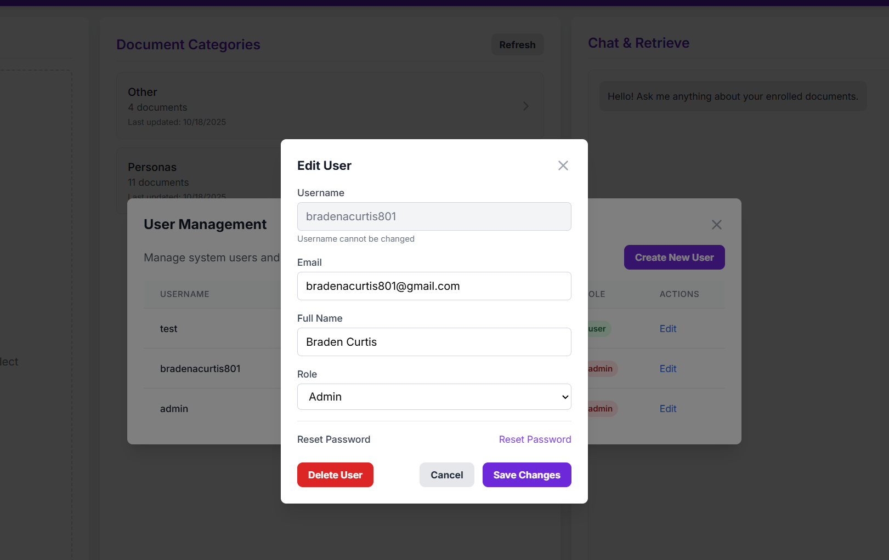
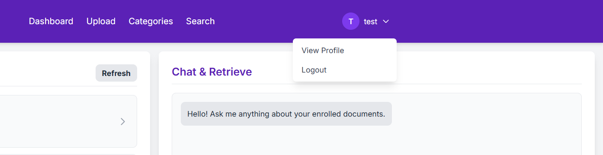

# ScanPro

A comprehensive document processing and search system that combines OCR, AI-powered document classification, and semantic search capabilities.

## 🎬 Demo

*Secure login interface with username and password authentication*

*Main dashboard showing document statistics, categories, and system overview*

*Real-time progress tracking during document upload with WebSocket integration*

*Upload completed with classification results and scrollable file lists*

*Category management interface with dynamic color-coded categories and scrollable document lists*

*User profile management with password change and profile editing capabilities*

*User menu dropdown with profile access and logout options*

*Admin interface for managing users, creating accounts, and assigning roles*

*Admin interface for editing user details, roles, and resetting passwords*

*Standard user profile view with limited editing capabilities*

## 🚀 Overview

ScanPro is a full-stack document management application with user authentication, role-based access control, and intelligent document processing. Users can upload documents, automatically classify them by type, and perform semantic searches across their document collection. The system is designed to handle Spanish legal documents including birth certificates, marriage certificates, and property deeds.

### 🔐 Authentication & User Management
- **User Authentication**: Secure login/logout with session management
- **Role-Based Access**: Admin and user roles with different permissions
- **User Management**: Admins can create, edit, and manage user accounts
- **Password Security**: Users can change passwords, admins can reset passwords
- **Session Security**: Automatic session invalidation on password changes

## 🔄 System Pipeline

### 1. Model Loading
**Location**: `backend/` directory

1. **Hugging Face Integration**: Automatically downloads fine-tuned BERT model from Hugging Face Hub
2. **Model Caching**: Caches model files locally in `APP_DATA/ml_models/` for faster subsequent loads
3. **Model Validation**: Validates model files and configuration on startup
4. **Critical Dependency**: Backend will crash if the fine-tuned model cannot be downloaded

### 2. Backend Processing
**Location**: `backend/` directory

1. **Document Upload**: Receive documents via FastAPI endpoints
2. **OCR Extraction**: Extract text using Tesseract with image preprocessing
3. **Document Classification**: Use fine-tuned BERT model to classify document types
4. **Embedding Generation**: Create vector embeddings for semantic search
5. **Index Storage**: Store documents in FAISS search index
6. **Search API**: Provide semantic search capabilities
7. **Feedback API**: Handle document reclassification and user corrections
8. **PDF Processing**: Convert PDF pages to images for display and OCR

### 3. Frontend Interface
**Location**: `frontend/` directory

1. **User Authentication**: Secure login/logout with session management
2. **Dashboard**: Overview of documents, categories, and system statistics
3. **Document Upload**: User-friendly interface for file uploads with drag & drop
4. **Category Management**: Browse and view documents organized by classification categories
5. **Document Classification**: Real-time document type classification with confidence scores
6. **Search Interface**: Query interface for semantic search
7. **Results Display**: Show search results with document metadata
8. **Document Management**: View and manage uploaded documents by category
9. **User Management**: Admin interface for managing users and roles
10. **User Profile**: Users can view and edit their profile information
11. **Feedback System**: Correct misclassifications and track model performance
12. **PDF Viewer**: View PDF documents with page-by-page image conversion
13. **Reclassification**: Easy document reclassification with "Did we get this wrong?" interface

## 🛠️ Getting Started

1. **Start Backend**: Launch the FastAPI server to process documents and provide search
2. **Start Frontend**: Launch the web interface to upload documents and search

The system automatically downloads the pre-trained model from Hugging Face Hub on first startup.

See individual component READMEs for detailed setup instructions.

## 🔄 System Flow

### Backend Processing
1. **Load Models**: Download and load fine-tuned BERT model from Hugging Face Hub
2. **Receive Documents**: Accept PDF and image uploads via API
3. **Extract Text**: Use Tesseract OCR to extract text from uploaded documents
4. **Classify Documents**: Use fine-tuned BERT model to determine document type
5. **Create Embeddings**: Generate vector embeddings for semantic search
6. **Store in Index**: Save documents and embeddings in searchable index
7. **Provide Search**: Return relevant documents based on user queries

### Frontend Interface
1. **Upload Documents**: Users upload PDFs and images through web interface
2. **Submit Queries**: Users search for documents using natural language
3. **View Results**: Display search results with document metadata and classification
4. **Manage Documents**: Browse and manage uploaded document collection

## 🚀 Model Deployment Strategy

### Development/Testing
- **Hugging Face Hub**: Models automatically downloaded from `bradenacurtis/scanpro-classifier-v1-finetune`
- **Local Caching**: Models cached in `APP_DATA/ml_models/` for faster subsequent loads
- **Fallback Support**: Similarity-based classifier available as fallback

### Production Deployment
- **Automatic Download**: Backend automatically downloads model on first startup
- **Caching**: Model files cached locally for performance
- **Token Support**: Optional Hugging Face token for private models via `SCANPRO_HF_TOKEN`

### Model Lifecycle
1. **Download**: Backend automatically downloads model from Hugging Face Hub
2. **Cache**: Model files cached locally in `APP_DATA/ml_models/`
3. **Load**: Model loaded into memory for inference
4. **Update**: New model versions automatically downloaded on restart

## 📚 Component Documentation

Each component has its own detailed documentation with setup instructions and code examples:

- **Training Pipeline**: `train/README.md` - Model training, data preparation, and evaluation
- **Backend Server**: `backend/README.md` - API documentation, setup, and deployment
- **Frontend Application**: `frontend/README.md` - User interface development and deployment

## 🎯 Key Technologies

- **Document Classification**: Fine-tuned BERT model from Hugging Face Hub
- **OCR Processing**: Tesseract for text extraction
- **Search Engine**: FAISS vector search with SentenceTransformer embeddings
- **Backend**: FastAPI for API services
- **Frontend**: Next.js for web interface
- **Model Management**: Hugging Face Hub integration for model distribution
