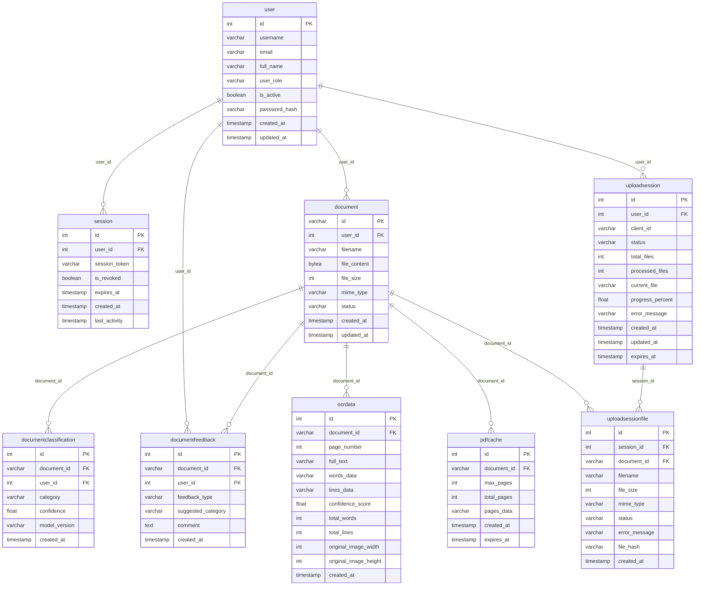

# ScanPro Database Schema

This directory contains the database schema documentation and diagrams for the ScanPro application.

## 📊 Database Diagram

### Mermaid ERD (Text-based)




## 🗂️ Files

- **`erd.png`** - Main database ERD diagram (PNG format)
- **`erd.svg`** - Scalable vector version of the ERD
- **`schema.sql`** - Complete database schema as SQL
- **`tables.md`** - Detailed table descriptions

## 🏗️ Database Structure

### Core Tables

#### **Authentication & Users**
- **`user`** - User accounts and authentication
- **`session`** - User session management

#### **Document Management**
- **`document`** - Uploaded document metadata
- **`documentclassification`** - AI classification results
- **`documentfeedback`** - User corrections and feedback

#### **Document Processing**
- **`ocrdata`** - OCR extraction results with detailed text data
- **`pdfcache`** - PDF processing cache

#### **Upload Management**
- **`uploadsession`** - Multi-file upload session tracking
- **`uploadsessionfile`** - Individual file tracking within upload sessions

## 🔗 Relationships

- **User** → **Session** (1:many)
- **User** → **Document** (1:many)
- **User** → **DocumentFeedback** (1:many)
- **User** → **UploadSession** (1:many)
- **Document** → **DocumentClassification** (1:many)
- **Document** → **DocumentFeedback** (1:many)
- **Document** → **OcrData** (1:many)
- **Document** → **PdfCache** (1:1)
- **Document** → **UploadSessionFile** (1:1)
- **UploadSession** → **UploadSessionFile** (1:many)

## 🛠️ Generating Diagrams

To regenerate the ERD diagram:

1. **Using pgAdmin:**
   - Connect to your PostgreSQL database
   - Right-click on "public" schema → "Generate ERD"
   - Export as PNG/SVG

2. **Using DBeaver:**
   - Connect to database
   - Right-click database → "Generate ERD"
   - Export in desired format

3. **Using command line:**
   ```bash
   # Export schema
   pg_dump --schema-only --no-owner --no-privileges -h localhost -U postgres scanpro_db > schema.sql
   ```

## 📝 Schema Updates

When making database changes:

1. Update the ERD diagram
2. Update `schema.sql` with new structure
3. Update this README if new tables are added
4. Document any breaking changes

## 🔒 Security Notes

- All user passwords are hashed using bcrypt
- Session tokens are securely generated
- Foreign key constraints ensure data integrity
- Indexes are optimized for common queries
